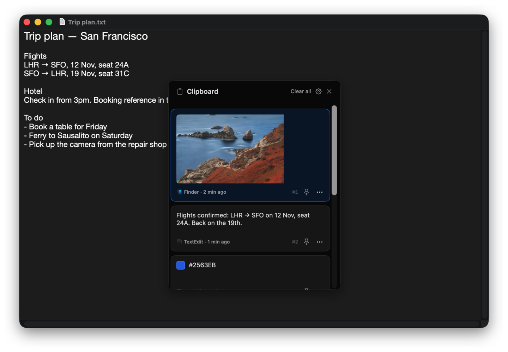
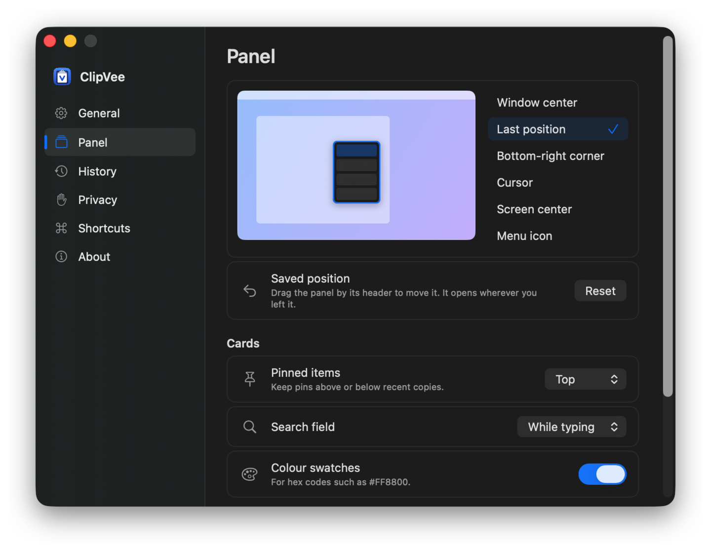

<p align="center">
  
</p>

<h1 align="center">ClipVee</h1>

<p align="center">
  Windows-style clipboard history for the Mac.<br>
  Press <kbd>⌘</kbd> <kbd>⇧</kbd> <kbd>V</kbd>, pick a card, and it's pasted.
</p>

<p align="center">
  <a href="https://mzbali.github.io/ClipVee/">Website</a> · <a href="https://github.com/mzbali/ClipVee/releases/latest">Download</a>
</p>

<p align="center">
  
</p>

## Why ClipVee

On Windows, <kbd>Win</kbd> + <kbd>V</kbd> opens a small panel of everything you've copied. macOS has nothing like it built in. ClipVee brings that panel to the Mac: it opens next to your work, you choose a card with the keyboard or mouse, and it's pasted into the app you were using.

## Features

- **Your history as cards.** Text, images with thumbnails, and files, newest first. Each card shows where and when it was copied.
- **Pastes straight in.** Select with <kbd>↑</kbd> <kbd>↓</kbd> and press <kbd>Return</kbd>, or click. <kbd>⌘1</kbd> to <kbd>⌘9</kbd> paste the nine newest items.
- **Pins.** Keep snippets you reuse at the top. Pins survive **Clear all** and get their own letter shortcut.
- **Type to search.** The search field appears as soon as you start typing.
- **Put it where you like.** In the middle of the window, at the pointer, by the menu bar icon, or wherever you last dragged it. Drag the bottom edge to make it taller.
- **Plain text when you need it.** Paste any formatted card without its fonts and colours, or make that the default.
- **Private.** Passwords copied from password managers are skipped. You can ignore whole apps, pause history, or skip just the next copy. Your history never leaves your Mac: ClipVee only goes online to check GitHub for updates, if you allow it.
- **Colour swatches** for hex codes such as `#FF8800`.

<p align="center">
  
</p>

## Install

ClipVee needs macOS 14 Sonoma or later, on an Apple silicon or Intel Mac.

1. Download the disk image (`.dmg`) from the [latest release](https://github.com/mzbali/ClipVee/releases/latest), open it, and drag **ClipVee** to Applications. Or install it with [Homebrew](https://brew.sh):

   ```sh
   brew install --cask mzbali/tap/clipvee
   ```

2. Open ClipVee. The first time, macOS says it can't check the app, because ClipVee isn't notarised by Apple. Click **Done**, then open System Settings → Privacy & Security, scroll down, and click **Open Anyway** next to ClipVee. You only need to do this once.
3. In System Settings → Privacy & Security → Accessibility, turn on **ClipVee**. It needs this to paste for you. Updates keep this setting. If you're updating from 1.0.0, remove ClipVee from the list with the minus button once, then turn the new copy on.
4. Press <kbd>⌘</kbd> <kbd>⇧</kbd> <kbd>V</kbd>.

ClipVee asks whether to check for updates automatically, and installs new versions when you click **Install**. You can also click **Check now** in Settings → General. Your history and settings carry over. Version 1.0.1 and earlier can't check for updates, so replace it with the new version once.

### Build it yourself

With Xcode installed:

```sh
git clone https://github.com/mzbali/ClipVee.git
cd ClipVee
./scripts/build-local.sh
```

Copy `.build/DerivedData/Build/Products/Debug/ClipVee.app` to your Applications folder, then follow steps 3 and 4 above.

Builds without a signing identity are signed ad hoc, and macOS asks for Accessibility again after every rebuild. To avoid that, sign with your own Apple Development certificate:

```sh
CLIPVEE_SIGN_IDENTITY='Apple Development: you@example.com (TEAMID)' ./scripts/build-local.sh
```

### Coming from Maccy

ClipVee can bring over your Maccy history, pins and settings. Open ClipVee once and quit it, quit Maccy, then run:

```sh
./scripts/migrate-history.sh
```

Maccy's own data isn't changed. Only run one of the two with <kbd>⌘</kbd> <kbd>⇧</kbd> <kbd>V</kbd> at a time.

## Keyboard

| Keys | What it does |
| --- | --- |
| <kbd>⌘</kbd> <kbd>⇧</kbd> <kbd>V</kbd> | Open or close the panel |
| <kbd>↑</kbd> <kbd>↓</kbd> | Select a card |
| <kbd>Return</kbd> or click | Paste |
| <kbd>⌘</kbd> <kbd>⇧</kbd> <kbd>Return</kbd> | Paste as plain text |
| <kbd>⌥</kbd> <kbd>Return</kbd> | Copy without pasting |
| <kbd>⌘1</kbd> to <kbd>⌘9</kbd> | Paste one of the nine newest items |
| <kbd>⌥</kbd> <kbd>P</kbd> | Pin or unpin |
| <kbd>⌥</kbd> <kbd>⌫</kbd> | Delete |
| <kbd>Esc</kbd> | Close |
| <kbd>⌘</kbd> <kbd>,</kbd> | Settings |

All of these can be changed in Settings → Shortcuts, and Settings → General decides whether choosing a card pastes or only copies.

## How it differs from Maccy

ClipVee is a fork of [Maccy](https://github.com/p0deje/Maccy) 2.8.0. It keeps Maccy's clipboard capture, storage and privacy features, and changes how you see and use your history.

| | Maccy | ClipVee |
| --- | --- | --- |
| Look | A menu-style list | A panel of cards, like Windows 11 |
| Shortcut | <kbd>⌘</kbd> <kbd>⇧</kbd> <kbd>C</kbd> | <kbd>⌘</kbd> <kbd>⇧</kbd> <kbd>V</kbd> |
| Choosing an item | Copies it | Pastes it into the app you were using |
| Settings | Tabs | A sidebar, with a picture of the screen for placing the panel |

## Contributing

Issues and pull requests are welcome. ClipVee is about clipboard history only, so it won't gain emoji, GIF or AI tabs.

[LOCAL_DEVELOPMENT.md](LOCAL_DEVELOPMENT.md) covers building, signing and tests. Inside the project, the code still uses Maccy's names, so fixes from Maccy can be merged in easily.

## Credits and licence

ClipVee is built on [Maccy](https://maccy.app) by Alex Rodionov and contributors, released under the [MIT License](LICENSE). ClipVee is maintained separately, so please report ClipVee problems here rather than to Maccy.
