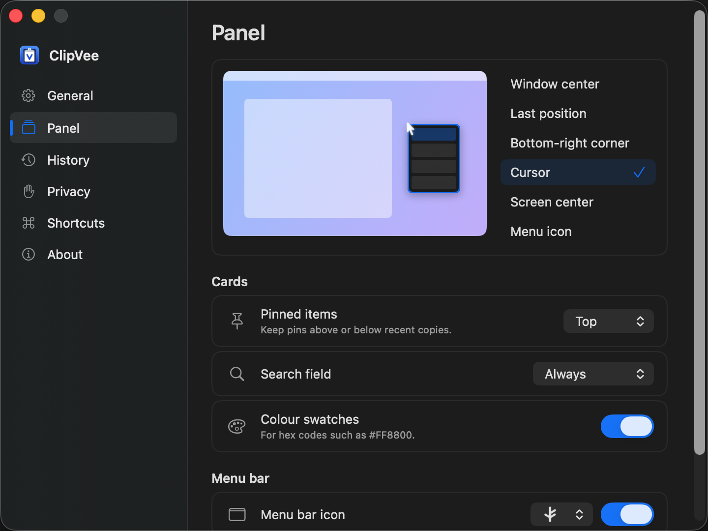

<p align="center">
  
</p>

<h1 align="center">ClipVee</h1>

<p align="center">
  Windows-style clipboard history for the Mac.<br>
  Press <kbd>⌘</kbd> <kbd>⇧</kbd> <kbd>V</kbd>, pick a card, and it's pasted.
</p>

<p align="center">
  <a href="https://mzbali.github.io/ClipVee/">Website</a> · <a href="https://github.com/mzbali/ClipVee/releases/latest">Download</a> · <a href="https://github.com/mzbali/ClipVee/releases">Release notes</a> · <a href="https://github.com/mzbali/ClipVee/issues">Report a problem</a>
</p>

<p align="center">
  
</p>

## Features

- **Cards, not a list.** Text, images and files, newest first, with the app and time they came from.
- **Pastes for you.** <kbd>↑</kbd> <kbd>↓</kbd> then <kbd>Return</kbd> or <kbd>⌘V</kbd>, or click. <kbd>⌘1</kbd>–<kbd>⌘9</kbd> paste the nine newest.
- **Pins** stay at the top and survive clearing history.
- **Search** by typing. The field can show always, only while typing, or never.
- **Opens where you want:** window centre, pointer, menu bar icon, or wherever you last dragged it.
- **Plain-text paste** for formatted copies, and **colour swatches** for hex codes like `#FF8800`.

<p align="center">
  
</p>

## Install

Needs macOS 14 Sonoma or later, on Apple silicon or Intel.

1. Download the `.dmg` from the [latest release](https://github.com/mzbali/ClipVee/releases/latest) and drag **ClipVee** to Applications, or run:

   ```sh
   brew install --cask mzbali/tap/clipvee
   ```

2. Open ClipVee. It isn't notarised by Apple yet, so the first time macOS blocks it: click **Done**, then **Open Anyway** in System Settings → Privacy & Security.
3. In the welcome window, click **Allow…** and turn on ClipVee under Accessibility. This lets it paste for you.

Then press <kbd>⌘</kbd> <kbd>⇧</kbd> <kbd>V</kbd>. Updates install from inside the app, and your history and settings carry over.

## Keyboard

| Keys | Action |
| --- | --- |
| <kbd>⌘</kbd> <kbd>⇧</kbd> <kbd>V</kbd> | Open or close the panel |
| <kbd>↑</kbd> <kbd>↓</kbd> | Select a card |
| <kbd>Return</kbd>, <kbd>⌘V</kbd> or click | Paste |
| <kbd>⌘</kbd> <kbd>⇧</kbd> <kbd>Return</kbd> | Paste as plain text |
| <kbd>⌥</kbd> <kbd>Return</kbd> | Copy without pasting |
| <kbd>⌘1</kbd>–<kbd>⌘9</kbd> | Paste one of the nine newest |
| <kbd>⌥</kbd> <kbd>P</kbd> | Pin or unpin |
| <kbd>⌥</kbd> <kbd>⌫</kbd> | Delete |
| <kbd>Esc</kbd> | Close |
| <kbd>⌘</kbd> <kbd>,</kbd> | Settings |

Change the panel, pin and delete shortcuts in Settings → Shortcuts.

## Privacy

- History stays on this Mac. There's no sync, and the only network use is the optional update check with GitHub.
- ClipVee skips copies that apps mark as sensitive, such as from password managers. Plain text that happens to be a password is still saved, so ignore apps in Settings → Privacy if you need to.
- Pause from the panel's **…** menu, or Option-click the menu bar icon. Option-Shift-click skips just the next copy.
- ClipVee keeps 200 unpinned items by default; change it in Settings → History. **Clear History…** in the **…** menu removes everything except pins.

## Troubleshooting

| Problem | Fix |
| --- | --- |
| A card copies but doesn't paste | Turn on **Paste automatically** and **Accessibility permission** in Settings → General. |
| Accessibility is on but pasting fails after an update | Remove ClipVee from the Accessibility list with the minus button, add it again, and reopen it. |
| New copies don't appear | Resume history if paused, and check Settings → History and Settings → Privacy. |
| The shortcut does nothing | Check Settings → Shortcuts for a clash with another app, or click the menu bar icon. In password fields, shortcuts that type a character, such as Option-C, are blocked by macOS; use one like ⌘⇧V. |

Still stuck? [Open an issue](https://github.com/mzbali/ClipVee/issues) with your macOS and ClipVee versions and the steps to reproduce. Leave real clipboard contents out of screenshots.

## Contributing

Issues and pull requests are welcome. ClipVee is clipboard history only, so it won't gain emoji, GIF or AI tabs. [LOCAL_DEVELOPMENT.md](LOCAL_DEVELOPMENT.md) covers building, signing and tests.

## Credits and licence

ClipVee is a fork of [Maccy](https://maccy.app) 2.8.0 by Alex Rodionov and contributors, under the [MIT License](LICENSE). Please report ClipVee problems here, not to Maccy.
