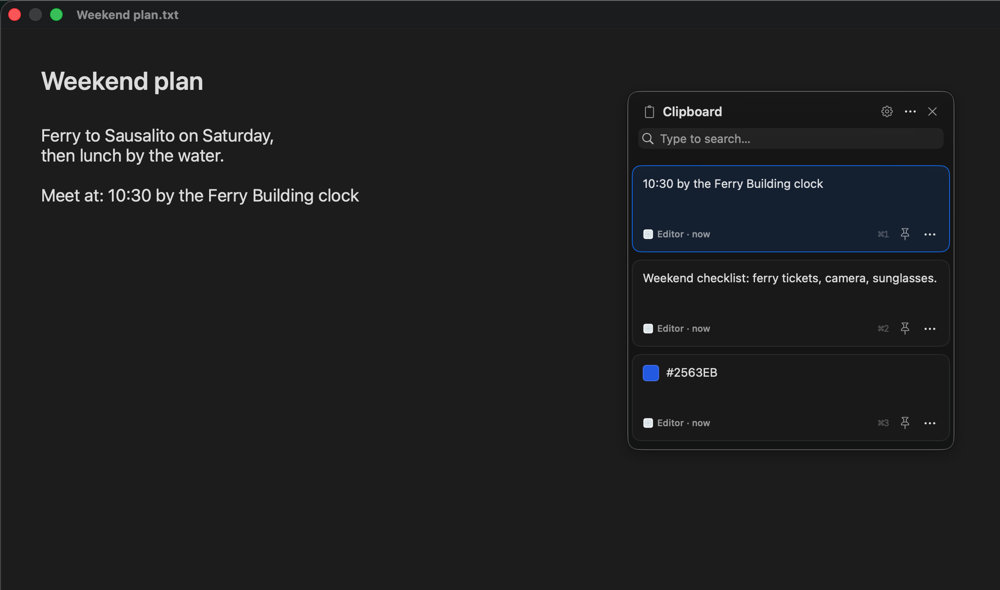

<p align="center">
  
</p>

<h1 align="center">ClipVee</h1>

<p align="center">
  Windows-style clipboard history for the Mac.<br>
  Press <kbd>⌘</kbd> <kbd>⇧</kbd> <kbd>V</kbd>, pick a card, and it's pasted.
</p>

<p align="center">
  <a href="https://mzbali.github.io/ClipVee/">Website</a> · <a href="https://github.com/mzbali/ClipVee/releases/latest">Download</a> · <a href="https://github.com/mzbali/ClipVee/releases">Release notes</a> · <a href="https://github.com/mzbali/ClipVee/issues">Report a problem</a>
</p>

<p align="center">
  
</p>

## Why ClipVee

On Windows, <kbd>Win</kbd> + <kbd>V</kbd> opens a small panel of recent copies. Modern macOS also has [clipboard history in Spotlight](https://support.apple.com/guide/mac-help/mchl40d5b86b/mac). ClipVee offers a dedicated Windows-style panel: one global shortcut opens it next to your work, you choose a card with the keyboard or mouse, and it's pasted into the app you were using. You can pin reusable items and choose where the panel opens. ClipVee supports macOS 14 Sonoma and later.

## Features

- **Your history as cards.** Text, images with thumbnails, and files, newest first. Each card shows where and when it was copied.
- **Pastes straight in.** Select with <kbd>↑</kbd> <kbd>↓</kbd> and press <kbd>Return</kbd> or <kbd>⌘V</kbd>, or click. <kbd>⌘1</kbd> to <kbd>⌘9</kbd> paste the nine newest items.
- **Pins.** Keep snippets you reuse at the top. Pins survive clearing history and get their own letter shortcut.
- **Type to search.** Click the search field or just start typing. In Settings → Panel, show the field always, only while you type, or never.
- **Put it where you like.** In the middle of the window, at the pointer, by the menu bar icon, or wherever you last dragged it. The shortcut and left-click open the panel in your chosen position. Right-click the menu bar icon for options. Drag the bottom edge to make it taller.
- **Plain text when you need it.** Paste any formatted card without its fonts and colours, or make that the default.
- **Local history.** ClipVee skips clipboard content marked sensitive or temporary by supported apps, including password managers that provide those markers. It cannot recognise every password or secret copied as ordinary text. You can ignore whole apps, pause history, or skip just the next copy. Your history stays on this Mac; the optional updater contacts GitHub for update information.
- **Colour swatches** for hex codes such as `#FF8800`.

<p align="center">
  
</p>

## Install

ClipVee needs macOS 14 Sonoma or later, on an Apple silicon or Intel Mac.

1. Download the disk image (`.dmg`) from the [latest release](https://github.com/mzbali/ClipVee/releases/latest), open it, and drag **ClipVee** to Applications. Or install it with [Homebrew](https://brew.sh):

   ```sh
   brew install --cask mzbali/tap/clipvee
   ```

2. Open ClipVee. The first time, macOS says it can't check the app, because ClipVee isn't notarised by Apple. Click **Done**, then open System Settings → Privacy & Security, scroll down, and click **Open Anyway** next to ClipVee. You only need to do this once.
3. ClipVee opens a welcome window. Click **Allow…**, then turn on **ClipVee** in System Settings → Privacy & Security → Accessibility. It needs this to paste for you. You can also find **Accessibility permission** in Settings → General. If you're updating from 1.0.0, remove ClipVee from the list with the minus button once, then turn the new copy on.
4. Press <kbd>⌘</kbd> <kbd>⇧</kbd> <kbd>V</kbd>.

ClipVee asks whether to check for updates automatically, and installs new versions when you click **Install**. You can also click **Check now** in Settings → General. Your history and settings carry over. Version 1.0.1 and earlier can't check for updates, so replace it with the new version once.

### Try your first paste

1. Copy a short sentence in TextEdit or another text editor.
2. Leave the cursor where you want to insert it, press <kbd>⌘</kbd> <kbd>⇧</kbd> <kbd>V</kbd>, then click the matching card or press <kbd>Return</kbd>.
3. The sentence should appear at the cursor. To find an older copy, open the panel and start typing.

If choosing a card only copies it, check **Paste automatically** and **Accessibility permission** in Settings → General. If new copies don't appear, check the panel's paused/capture-off message and Settings → History.

### Everyday controls and privacy

- Left-click the menu bar icon or use your shortcut to open the panel at your chosen position. Right-click or Control-click the icon for options.
- Pause history from the panel's **More actions** menu or Settings → Privacy. Option-click the menu bar icon to toggle pause; Option-Shift-click skips only the next copy. Pausing stops new capture and keeps existing history.
- ClipVee keeps **200 unpinned items by default**. Change the limit in Settings → History. Older unpinned items are removed as the limit is reached; pinned items don't count toward it.
- History is saved on disk and survives quitting by default. **Clear History…** (in the panel's “…” menu) removes unpinned history and keeps pins. It only clears what Command-V would paste if **Clear the system clipboard too** is enabled in Settings → History.
- Settings → Privacy lets you ignore source apps. Sensitive-content markers depend on the app you copy from; ordinary-text secrets can still be saved. History stays on this Mac, with no built-in sync.

### Troubleshooting and feedback

| Symptom | What to check |
| --- | --- |
| A card copies but doesn't paste | Leave a text cursor in the destination app. In Settings → General, check **Paste automatically** and **Accessibility permission**. |
| Accessibility is enabled but paste still fails after replacing the app | Quit ClipVee, remove its old Accessibility entry, add the current `/Applications/ClipVee.app`, then reopen it. |
| New copies don't appear | Resume history if paused; enable the relevant text, image or file capture in Settings → History. Check ignored apps, clipboard types and patterns in Settings → Privacy. Skipped copies aren't recovered later. |
| The shortcut doesn't open the panel | Confirm or record it in Settings → Shortcuts and check whether another app uses the same shortcut. You can also left-click the menu bar icon. |

Still stuck? [Report a ClipVee problem](https://github.com/mzbali/ClipVee/issues) with your macOS version, ClipVee version from Settings → About, steps to reproduce, and what you expected to happen. Use a made-up example and redact clipboard contents from screenshots.

### Build it yourself

With Xcode installed:

```sh
git clone https://github.com/mzbali/ClipVee.git
cd ClipVee
./scripts/build-local.sh
```

Copy `.build/DerivedData/Build/Products/Debug/ClipVee.app` to your Applications folder, then follow steps 3 and 4 above.

Builds without a signing identity are signed ad hoc, and macOS asks for Accessibility again after every rebuild. To avoid that, sign with your own Apple Development certificate:

```sh
CLIPVEE_SIGN_IDENTITY='Apple Development: you@example.com (TEAMID)' ./scripts/build-local.sh
```

## Keyboard

| Keys | What it does |
| --- | --- |
| <kbd>⌘</kbd> <kbd>⇧</kbd> <kbd>V</kbd> | Open or close the panel |
| <kbd>↑</kbd> <kbd>↓</kbd> | Select a card |
| <kbd>Return</kbd> or click | Paste |
| <kbd>⌘</kbd> <kbd>⇧</kbd> <kbd>Return</kbd> | Paste as plain text |
| <kbd>⌥</kbd> <kbd>Return</kbd> | Copy without pasting |
| <kbd>⌘1</kbd> to <kbd>⌘9</kbd> | Paste one of the nine newest items |
| <kbd>⌥</kbd> <kbd>P</kbd> | Pin or unpin |
| <kbd>⌥</kbd> <kbd>⌫</kbd> | Delete |
| <kbd>Esc</kbd> | Close |
| <kbd>⌘</kbd> <kbd>,</kbd> | Settings |

These are the defaults with automatic paste enabled. Settings → Shortcuts lets you change the panel, pin, delete and details shortcuts, and shows the current copy/paste modifier keys. Settings → General decides whether choosing a card pastes, pastes as plain text or only copies.

## Contributing

Issues and pull requests are welcome. ClipVee is about clipboard history only, so it won't gain emoji, GIF or AI tabs.

[LOCAL_DEVELOPMENT.md](LOCAL_DEVELOPMENT.md) covers building, signing and tests. Inside the project, the code still uses Maccy's names, so fixes from Maccy can be merged in easily.

## Credits and licence

ClipVee is a fork of [Maccy](https://maccy.app) 2.8.0 by Alex Rodionov and contributors, released under the [MIT License](LICENSE). Its clipboard capture, storage and privacy features provide the foundation for ClipVee's panel. ClipVee is maintained separately, so please report ClipVee problems here rather than to Maccy.
